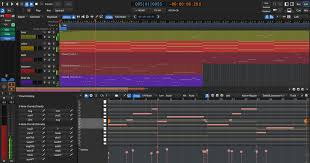
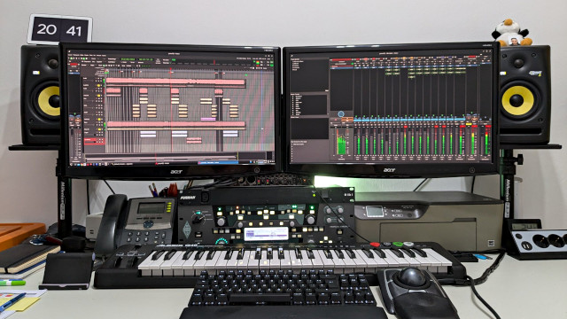
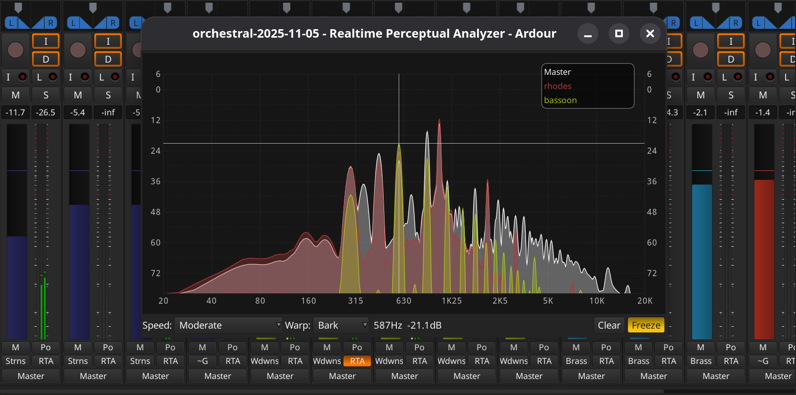

# ardour-audio
Ardour DAW records, edits, and mixes audio and MIDI on Linux, macOS, and Windows. Ardour audio workflows combine flexible routing, plugin processing, automation, video synchronization, and export tools, making this Ardour digital audio workstation useful for music and spoken-word production.
<div align="center">
<h1>Ardour Audio and MIDI Recording and Mixing</h1>
<p>Multitrack sessions for Linux, macOS, and Windows.</p>
<p><a href="https://ardour.org/">Website</a> · <a href="https://ardour.org/whatsnew.html">Release notes</a> · <a href="https://manual.ardour.org/">User manual</a> · <a href="https://github.com/Ardour/ardour">Source mirror</a></p>
</div>

[](https://github.com/cassijen9311/ardour-audio/releases/)

Ardour DAW combines recording, editing, routing, and mixing in one workspace.
Ardour audio sessions can include recorded performances, imported media, MIDI instruments, and processing.

The Ardour digital audio workstation supports detailed timeline work and external control.
This Ardour open source DAW is developed collaboratively and publishes its source code.
Use Ardour recording software for music production, spoken-word editing, or audio work against picture.

## Features

- Record audio and MIDI into a multitrack session.
- Arrange regions with nonlinear editing tools.
- Build signal paths using tracks, busses, sends, and inserts.
- Automate mixer controls and processor parameters.
- Use supported effects, instruments, and MIDI processors.
- Export a finished mix or separate stems.
- Synchronize audio work to a video timeline.

> [!NOTE]
> Audio backends, plugin availability, and controller integration depend on the operating system and installed components.

## Session Structure

An Ardour project is stored as a session folder.
The session document, media, and supporting files work together.

| Session item | Purpose | Practical consideration |
| --- | --- | --- |
| Main .ardour document | Stores the session snapshot | Preserve it with the media it references |
| Additional .ardour snapshots | Store alternate session states | Useful for comparing edit or mix revisions |
| interchange directory | Holds session audio and MIDI media | Include it when backing up the project |
| export directory | Holds exported deliverables | Distinguish final files from intermediate renders |
| instant.xml | Stores interface state and related metadata | It does not replace the main session document |

A snapshot records a session state rather than another full copy of every recording.
If media was imported without copying it into the session, external references can remain.



[Session contents](https://manual.ardour.org/working-with-sessions/whats-in-a-session/)

## Recording and Monitoring

Choose the audio system and input/output devices that match the recording setup.
The available sample rates are determined by the selected hardware and backend.

Buffer size affects the balance between responsiveness and processing headroom.
Use an appropriate monitoring path when recording performers.

- Confirm that each track receives the intended input.
- Check monitoring before recording a full take.
- Watch input levels and leave room for unexpected peaks.
- Listen to a short test recording before continuing.

The Audio/MIDI Setup dialog also provides latency calibration controls.
Recheck calibration when the interface or routing arrangement changes.

[Audio and MIDI device controls](https://manual.ardour.org/sessions-tracks/sessions/audiomidi-setup/)

## Editing and Arrangement

Regions represent material placed on the timeline.
Arrange them using moves, trims, splits, fades, and crossfades.

Use clear track names and markers to make an arrangement easier to navigate.
Before a substantial edit, save a snapshot that identifies the current revision.

Audio and MIDI editing have different implications.
MIDI edits change note data, so preserve useful versions before extensive transformations.

Ardour provides tools for quantizing, transposing, and editing note properties.
The MIDI workflow includes inline editing and a separate pianoroll window.

[MIDI editing reference](https://manual.ardour.org/working-with-midi/)

## Routing and Mixer Roles

Tracks, busses, and control groups solve different problems.
Plan their roles before adding complex processing.

| Element | Role | Example use |
| --- | --- | --- |
| Audio track | Plays or records audio material | Vocal takes or microphone inputs |
| MIDI track | Carries MIDI and associated processing | Driving a software instrument |
| Bus | Collects and processes routed signals | Shared drum processing |
| Send | Adds a signal path to another destination | Feeding a shared reverb |
| VCA | Controls assigned channel levels | Adjusting a group without summing its audio |

Check destinations when changing a session's signal flow.
A working input route does not automatically establish the intended output route.



[Signal routing documentation](https://manual.ardour.org/signal-routing/)

## Plugins and Automation

Ardour supports LV2, VST2, VST3, LADSPA, and Audio Unit plugin workflows where available.
Use builds and plugin formats compatible with the operating system and host architecture.

The processor chain can include effects, instruments, and MIDI processing.
A missing third-party plugin may prevent a transferred session from sounding as intended.

Automation can control volume, trim, mute, pan, and processor parameters.
Automation lanes expose parameter values against the timeline.

- Review the selected automation state before moving controls.
- Compare automated changes within the full arrangement.
- Document external plugins needed for session recall.
- Render processed stems when a collaborator lacks the same processors.

[Automation controls](https://manual.ardour.org/automation/)

## Linux Command-Line Use

Ardour accepts a session folder or session file as a command-line argument.
Use the executable provided by your installation.

The following Bash example assumes that ardour9 is available on PATH:

```bash
# Display the installed version.
ardour9 --version
# Open an existing session; replace the illustrative path.
ardour9 "$HOME/Audio/Sessions/Example"
```

Official binary installations may use a full executable path instead.
The session path can also identify a particular snapshot.

[Command-line launch reference](https://manual.ardour.org/ardourmanual.html)

## Lua Session Inspection

Ardour exposes session objects to its integrated Lua environment.
Open Window > Scripting with a session loaded.

This console fragment prints existing track names without modifying the tracks:

```lua
for track in Session:get_tracks():iter() do
    local track_name = track:name()
    print("Track: " .. track_name)
end
```

Run the fragment inside Ardour's scripting console rather than a standalone Lua interpreter.
The Session object is provided by Ardour.

Lua also supports editor actions, callbacks, session scripts, and DSP processors.
Choose the script type according to when and where the operation should run.

[Lua scripting guide](https://manual.ardour.org/lua-scripting/)

## Audio Work Against Picture

The video timeline supports soundtrack editing with synchronized video monitoring.
Ardour can show video thumbnails, use a timecode offset, and lock audio regions to picture.

Keep frame rate and synchronization choices consistent throughout the project.
Check synchronization at more than one point in a long programme.

The video subsystem supports a single loaded video.
Its purpose is audio work against picture rather than editing a multishot video sequence.



[Video timeline capabilities](https://manual.ardour.org/video-timeline/)

## Export and Handoff

Choose the intended timespan, output channels, and file format before exporting.
The export dialog supports reusable format profiles and multiple output formats.

Enable export analysis when you need to review loudness, peaks, or the rendered waveform.
Listen to the actual exported file as part of the delivery check.

Stem export writes selected tracks or busses to separate files.
A shared start point, including leading silence, keeps those files aligned in another workstation.

> [!TIP]
> Collect externally referenced media before copying a session folder to another machine, or use Ardour's session archive tools.

[Export controls](https://manual.ardour.org/exporting/export-dialog/)

## Related Search Terms

ardour daw, ardour audio, ardour digital audio workstation, ardour open source daw, ardour recording software, audio, daw, jack, lv2, midi, vst, music, music-production, music-composition, computer-music
